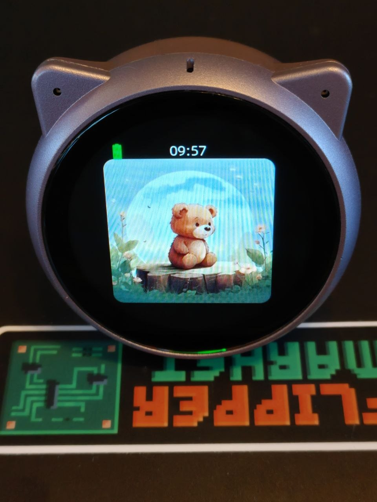
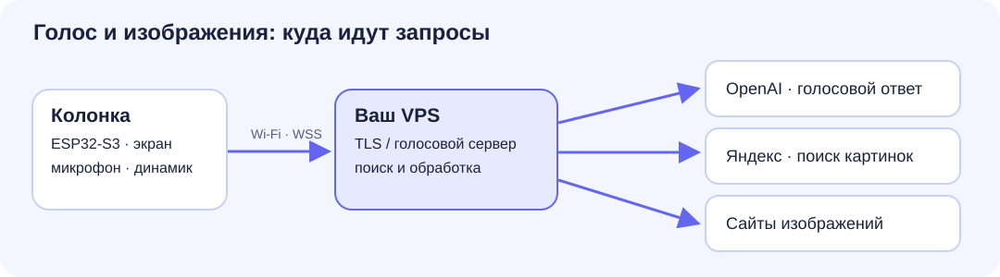

# EchoEar + ChatGPT + Яндекс Картинки

Проект превращает колонку EchoEar-2ST на ESP32-S3 в голосового помощника с собственным сервером: она разговаривает через OpenAI Realtime API и показывает изображения, найденные через Яндекс Search API. Изображения **ищутся в интернете**, а не генерируются OpenAI.



Базовая версия прошивки и сервера проверена совместно на одном устройстве EchoEar-2ST. Настройка OTA через портал, добавленная в опубликованные исходники, ещё требует проверки на устройстве. Другие ревизии и устройства с похожим названием могут отличаться распиновкой и разметкой памяти. Настройка нового устройства и сервера требует самостоятельной подготовки и проверки.



Колонка общается с вашим сервером по защищённому соединению. Сервер передаёт голосовые данные в OpenAI, текст поискового запроса — в Яндекс и может загрузить найденное изображение с внешнего сайта. Таким образом, VPS — точка подключения колонки, но эти внешние сервисы тоже получают необходимые для работы данные.

## Улучшения и исправления

Сравнение относится к снимку [Denis-VR/xiaozhi-esp32](https://github.com/Denis-VR/xiaozhi-esp32/tree/41c79363538cce4513a1b4375758dd2f4f650fdb) с коммитом `41c79363538cce4513a1b4375758dd2f4f650fdb`. Это описание изменений нашего варианта для EchoEar-2ST и сопровождающего сервера, а не оценка всех версий исходного проекта или заводской прошивки колонки.

- **Плата и голосовой сервер.** Добавлен отдельный профиль EchoEar-2ST: экран, сенсор, аудиокодек и примерная оценка заряда. Колонка работает с нашим сервером и OpenAI Realtime API; для картинок сервер обращается к Яндекс Search API. Старый MQTT-маршрут для этой платы не используется.
- **Постоянная связь во время работы.** При поддержке сервером функции `persistent_idle` колонка сохраняет WebSocket между репликами. Сервер отправляет служебный heartbeat, а прошивка отслеживает отсутствие входящих данных и повторяет подключение с увеличивающейся задержкой. Это сокращает необходимость создавать соединение перед каждой репликой, но зависит от работы Wi‑Fi, VPS и совместимого сервера. В режиме отдыха соединение специально закрывается.
- **Восстановление после обрыва Wi‑Fi.** Добавлена обработка отключения сети и изменения IP-адреса: старая сессия закрывается, а подключение повторяется после возвращения сети. Создание и закрытие соединения вынесены из основного цикла в отдельные задачи, чтобы медленная сеть меньше задерживала управление колонкой. Эти механизмы не гарантируют мгновенного восстановления при любом отказе.
- **Окончание и прерывание разговора.** Команды прослушивания и события ответа связываются с идентификатором текущей реплики; устаревшие события прежнего соединения или реплики отбрасываются. Для выхода в ожидание используется отдельное сообщение `standby`, а повторное касание во время прослушивания отправляет паузу. Это рассчитано на совместную работу с нашим сервером.
- **Передача звука.** На сервере добавлены ограниченная очередь кадров, начальная буферизация и отправка Opus-кадров с интервалом воспроизведения; при переполнении предусмотрено восстановление сессии. На колонке добавлены проверки длины входящих пакетов и защита от обработки событий закрытого соединения. При испытании на одной колонке пользователь отметил, что звук стал плавнее; количественных измерений потерь и задержки для разных сетей нет.
- **Очередь воспроизведения.** В прошивке учитываются декодирование и вывод, которые уже начались, а не только содержимое очередей; после сброса устаревшие аудиозадачи не должны попадать в новое воспроизведение. Звук касания подмешивается в аудиовыход, а начало прослушивания согласуется с его окончанием. При этом возможность потери первого аудиопакета из-за порядка событий остаётся отдельным неисключённым риском: исследовательское исправление для неё в эту версию не включено.
- **Ожидание и отдых.** Добавлен программный режим отдыха: выключаются подсветка и микрофон, закрывается соединение, но локальный будильник продолжает работать. Касание запускает пробуждение и восстановление связи. Это отдельный режим, а не аппаратное отключение питания или универсальное исправление зависания при глубоком сне.
- **Сохранность настроек.** Для EchoEar-2ST ошибка инициализации NVS больше не вызывает автоматическое стирание раздела с Wi‑Fi и другими настройками: запуск останавливается, чтобы данные можно было исследовать и восстановить. Для остальных плат исходная ветка обработки сохранена.
- **Диагностика и управление.** Добавлены локальные будильники, голосовое управление яркостью и громкостью, индикатор примерного заряда и ограниченные технические события на VPS. В WebSocket-пути больше не выводится содержимое некорректного JSON при ошибке разбора.

На физической колонке проверены разговор, звук касания, отдых и будильник в отдыхе; пользователь также сообщил о более плавном звуке и успешной второй реплике. Проверки не охватывают все варианты длительного простоя и обрывов сети. Ранее наблюдалось, что прослушивание иногда прерывалось до конца фразы; точная причина каждого такого случая не установлена. Настройка OTA через портал в этих исходниках и фраза готовности после пробуждения ещё требуют отдельной проверки на устройстве.

Основная реализация: [состояния и восстановление связи](firmware/main/application.cc), [WebSocket](firmware/main/protocols/websocket_protocol.cc), [очереди аудио](firmware/main/audio/audio_service.cc) и [передача кадров на сервере](server/voice/internal/service/ai/manual_device_actor.go).

## Возможности

- Разговор по касанию экрана и последующие реплики; короткий звук подтверждает распознанное касание. Повторное касание во время прослушивания может его остановить.
- Голосовое изменение громкости и яркости, а также ответ о **примерном** заряде батареи.
- Поиск картинки по голосовой просьбе, показ примерно на 30 секунд, закрепление как фона и удаление фона голосом. Закреплённый фон хранится на сервере и восстанавливается после подключения.
- Локальный будильник: сигнал повторяется до касания экрана; при тихой громкости она временно повышается и потом восстанавливается. Будильник работает и в режиме отдыха, пока устройство включено и часы установлены. При полном отключении питания он не прозвенит.
- Режим отдыха по голосовой команде: экран гаснет, микрофон останавливается, соединение с VPS закрывается. Касание запускает локальную фразу о пробуждении и повторное подключение; предусмотрена фраза о готовности. На момент снимка последняя фраза ещё не была проверена на слух.
- Технический журнал событий голосовой сессии на сервере может быть включён отдельно. Он не является полным USB-журналом устройства и не содержит запись речи или текст диалогов.


Режим отдыха не выключает питание. Для аппаратного выключения используется кнопка колонки. Поддержка музыкальных сервисов и загрузки музыки здесь не реализована. Семейный фильтр поиска включён, но не гарантирует приемлемость каждого изображения; найденные изображения могут содержать водяные знаки и подпадать под права их владельцев.

В текущем варианте время зафиксировано для UTC+5 (`Asia/Yekaterinburg`), без переходов на летнее и зимнее время: это касается часов и будильников. Другие часовые пояса пока не поддерживаются и требуют согласованных изменений прошивки и сервера.

## Что понадобится

- EchoEar-2ST с ESP32-S3, совместимый USB-кабель для передачи данных и компьютер для сборки.
- Ubuntu-сервер с постоянным доступом к сети, доменное имя и действующий TLS-сертификат для защищённого подключения колонки.
- Доступ к OpenAI API для голосовой модели и к Яндекс Search API для поиска изображений: ключ сервисного аккаунта и идентификатор каталога Яндекс Cloud. Использование API и VPS может оплачиваться отдельно; возможности и кредиты конкретной подписки проверяйте в своём аккаунте.
- ESP-IDF 5.5.1 для сборки прошивки, зависимости из `firmware/dependencies.lock`; для серверных компонентов также нужны Docker или соответствующие среды Go, Node.js и Python.


## Сервер

В `server/` находятся исходники голосового сервиса, TLS/WebSocket-шлюза и сервисов поиска и декодирования изображений. Их назначение, происхождение и ограничения воспроизводимости перечислены в [описании сервера](server/README.md). На новом VPS потребуются конфигурация сервисов, ключи, сертификат и сетевые настройки. Файлы из репозитория сами по себе не переключают и не устанавливают сервер.

В репозитории готовится установщик для отдельного Ubuntu VPS. Он запрашивает домен, email для Let's Encrypt, идентификатор каталога Яндекс Cloud и два ключа API; ключи вводятся скрыто. Часовой пояс пока фиксирован на UTC+5. Для сертификата нужен публичный DNS и доступный TCP-порт 80, для колонки — TCP-порт 18444. Команды из корня проекта:

```sh
sudo bash server/install/install.sh
sudo bash server/install/show-ota.sh
```

Установщик меняет настройки сервера и устанавливает пакеты. Его полный проход на чистой Ubuntu пока не подтверждён; перед применением изучите скрипт и проверьте доступность портов, особенно если на VPS уже работают другие сайты. Показанный второй командой адрес понадобится при настройке колонки.

Вход колонки должен быть защищён TLS и проверкой доступа; внутренние порты голосового сервиса и обработки изображений не следует открывать в интернет. Ключи API и персональные настройки хранятся вне репозитория. После настройки проверьте, что сервер доступен колонке, а также что у учётных записей API есть доступ к используемым сервисам.

## Подключение колонки по USB

1. Подключите колонку кабелем с передачей данных. Определите её последовательный порт: на Windows его можно найти в диспетчере устройств, на Linux — в списке `/dev/ttyACM*` и `/dev/ttyUSB*`. Имя порта отличается на разных компьютерах.
2. До записи сохраните полную резервную копию flash и проверьте её читаемость и размер. Сначала определите модель чипа, фактический размер flash и таблицу разделов конкретной колонки. Резервная копия может содержать настройки устройства.
3. Сверьте плату и разметку с целевой сборкой. Не применяйте без проверки общий рецепт полной прошивки, который может перезаписать загрузчик, таблицу разделов, настройки и штатные ресурсы.
4. Используйте способ записи, подходящий именно вашей текущей разметке и поддерживающий восстановление предыдущей прошивки. После записи проверьте загрузку, Wi‑Fi, экран, звук и доступность сервера.

Готового универсального установщика прошивки и проверенного рецепта записи для всех ревизий здесь пока нет. Разделение OTA и сохранение резервной копии особенно важны при первом эксперименте. Исходное описание платы в `firmware/main/boards/echoear-2st/README.md` относится к раннему этапу разработки; сведения о проверенных функциях приведены в этом документе.

## Сборка и адрес OTA

В этих исходниках предусмотрена настройка HTTPS-адреса OTA через Wi‑Fi портал, без персонализации прошивки для каждого устройства. Эта возможность прошла программные проверки, но пока не проверена на физической колонке. Ранее установленная версия использует адрес, заданный при сборке, и поле портала в ней на работу не влияет.

Для нового варианта подключитесь к точке настройки колонки, откройте `http://192.168.4.1`, выберите «Дополнительно», укажите адрес OTA своего сервера и сохраните настройки. Затем подключите колонку к домашней сети и перезапустите её. WebSocket должен использовать тот же домен и порт, что и OTA. Публичный `firmware/sdkconfig.echowear-reference` содержит неработающий резервный адрес.

После подготовки ESP-IDF перейдите в каталог `firmware` и выполните:

```sh
cp -n sdkconfig.echowear-reference sdkconfig
idf.py build
```

Команда `cp -n` сохраняет уже существующий `sdkconfig`. Если требуется дополнительно зафиксировать резервный адрес при сборке, используйте `python3 ../device/configure_ota.py` вместо копирования шаблона; адрес вводится в скрытом приглашении, а создаваемая конфигурация и бинарник становятся персональными. Подробности — в [device/README.md](device/README.md). Проверьте совместимость конфигурации, ресурсов и разметки вашей колонки до записи.

Поведение старта при ошибках NVS можно проверить на компьютере из каталога `firmware`: `bash tests/run_nvs_init_host_tests.sh`. Тест компилирует реальный `main.cc` с имитацией NVS API для EchoEar-2ST и другой платы; он не подключается к устройству.

## Если что-то не работает

| Симптом | Что проверить |
| --- | --- |
| USB-порт не появился | Кабель с передачей данных, питание, порт компьютера и драйвер USB; имя порта зависит от системы. |
| Колонка не отвечает | Дождитесь индикатора прослушивания после одного касания и произнесите фразу без повторного касания. Проверьте Wi‑Fi, доступность VPS и технический журнал. |
| Пробуждение затянулось | Проверьте соединение сервера и сертификат; режим отдыха закрывает подключение, поэтому ему нужно восстановиться. |
| Картинка не найдена | Проверьте ответ Search API и доступ сервера к изображениям. Отсутствие результатов отличается от технической ошибки поиска. |
| Будильник не звенит | Проверьте, что колонка включена, время синхронизировано и расписание сохранено. При полном выключении питания локальный будильник не работает. |
| Колонка подключается к старому сервису | Убедитесь, что установлена именно эта сборка с собственным адресом OTA; другие прошивки и сброшенные настройки могут вести себя иначе. |

## Исходники и лицензии

- Новые оригинальные дополнения проекта предоставляются по [MIT License](LICENSE); лицензии исходных и сторонних компонентов при этом сохраняются.
- Прошивка основана на [Denis-VR/xiaozhi-esp32](https://github.com/Denis-VR/xiaozhi-esp32), снимок `41c79363538cce4513a1b4375758dd2f4f650fdb`; её [лицензия MIT](firmware/LICENSE) и уведомления в исходниках сохранены.
- При разработке профиля платы использовалось описание [Muse OSTB EchoEar-2ST](https://github.com/facebookincubator/muse-gadget-sdk/blob/8d32b7fa8d6d9b600ea65fc956e9418f5c778a28/esp32/devices/ostb-echoear-2st.md). Инициализация дисплея отдельно атрибутирована в исходном файле.
- Голосовой сервер основан на [stackchan-ai-server](https://github.com/rudyll/stackchan-ai-server). Для снимка сервера сохранены [AGPL-3.0-only](server/voice/LICENSE), [NOTICE](server/voice/NOTICE.md) и лицензии отдельных частей в `server/voice/licenses/`.
- Встроенный компонент [esp-ml307](firmware/components/esp-ml307/LICENSE) распространяется на условиях Apache-2.0. Другие компоненты и зависимости сохраняют собственные лицензии и уведомления.

Карта компонентов и условий приведена в [NOTICE.md](NOTICE.md). Сохраняйте соответствующие уведомления и исходники при распространении и эксплуатации модифицированного сервера в соответствии с применимыми лицензиями.
