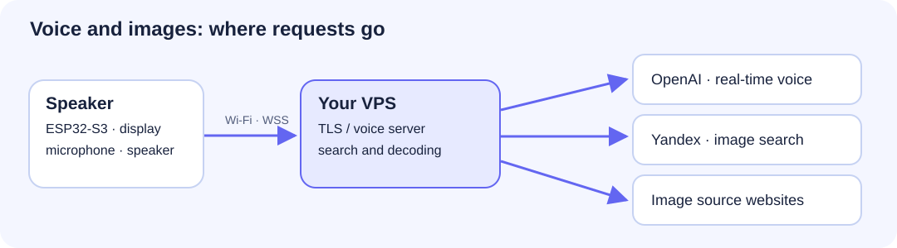

# EchoEar-ChatGPT-YandexApi

**English** · [Русский](README.ru.md) · [简体中文](README.zh-CN.md)

[](https://github.com/AlexeySmirnov74/EchoEar-ChatGPT-YandexApi/releases/latest)
[](https://github.com/AlexeySmirnov74/EchoEar-ChatGPT-YandexApi/actions/workflows/checks.yml)
[](firmware/main/boards/echoear-2st/README.md)
[](firmware/sdkconfig.echowear-reference)

[](server/install/README.md)
[](server/README.md)
[](server/image-search/)
[](server/gateway/)
[](README.md)

[](LICENSE)
[](server/voice/LICENSE)

Turn an EchoEar-2ST speaker into a voice assistant connected to your own VPS. Talk through OpenAI Realtime API, ask for pictures from Yandex Search API, set local alarms and control the screen by voice. Images are **searched for online**, not generated by OpenAI.


**[Download firmware v0.2.0](https://github.com/AlexeySmirnov74/EchoEar-ChatGPT-YandexApi/releases/latest)** · **[USB flashing and recovery guide](docs/FLASHING.md)** · **[VPS installation guide](server/install/README.md)**

The hardware target is **EchoEar-2ST without BaseBoard**, with ESP32-S3, 16 MiB flash and 8 MiB PSRAM. Firmware and server have been used together on one device. Other revisions can have different wiring and flash layouts. Detailed flashing and server guides are currently in Russian; the three README versions describe the same project. README translations do not change the firmware's Russian locale or its UTC+5 time zone.

## How it works



The speaker connects to your VPS over an authenticated TLS/WebSocket connection. The VPS sends voice data to OpenAI, image search queries to Yandex, and may download a selected image from its source website. The VPS is the speaker's entry point; those external services also receive the data needed for their functions.

API keys stay on the VPS. The distributable firmware contains no personal VPS address, Wi-Fi password or API key. Save your own HTTPS OTA URL in the speaker's browser-based Wi-Fi portal; WebSocket uses the same host and port. Legacy MQTT routing is disabled for this board.

## Features

- **Touch to talk.** A short sound acknowledges a recognized touch. Follow-up turns are supported. Touching again while listening can stop the current turn.
- **Voice controls.** Change speaker volume and screen brightness, or ask for an **approximate** battery percentage.
- **Pictures.** Search for an image by voice, show it for about 30 seconds, pin it as a background, or remove it by voice. A pinned background is stored on the server and restored after reconnecting.
- **Local alarms.** The melody repeats until you touch the screen. Quiet volume is temporarily raised and restored afterward. Alarms also work during display rest while the device remains powered and its clock is set; they cannot ring with power fully off.
- **Display rest.** A voice command blanks the screen, stops the microphone and closes the VPS connection. Touch starts the local wake-up prompt and reconnects. A ready prompt is implemented; its playback still needs a separate listening check.
- **Technical event log.** An optional bounded voice-session event log lives on the VPS. It contains neither speech recordings nor dialogue transcripts and is not a complete USB device log.

Examples of Russian voice commands used with this build:

| Command | Action |
| --- | --- |
| «Установи громкость на 30 процентов» | Set volume to 30%. |
| «Установи яркость на 70 процентов» | Set brightness to 70%. |
| «Какой заряд батареи?» | Report the estimated charge. |
| «Покажи картинку зайчика» | Search for and display a rabbit picture. |
| «Сделай картинку постоянной» | Keep the current picture as a background. |
| «Убери картинку с экрана» | Remove the picture. |
| «Поставь будильник через две минуты» | Set a local alarm. |
| «Иди спать» | Enter display rest. |
| «Что ты умеешь?» | Describe available commands. |


Rest keeps the device powered; use its physical button to switch power off. Music-service integration is not implemented. Family image-search filtering is enabled, but it cannot ensure every result is suitable; images may contain watermarks and remain subject to their owners' rights.

Time and alarms currently use **UTC+5 (`Asia/Yekaterinburg`)**, with no daylight-saving changes. Other time zones need coordinated firmware and server changes.

## Improvements and fixes

The starting point is [Denis-VR/xiaozhi-esp32](https://github.com/Denis-VR/xiaozhi-esp32/tree/41c79363538cce4513a1b4375758dd2f4f650fdb), commit `41c79363538cce4513a1b4375758dd2f4f650fdb`. The following describes changes to this EchoEar-2ST integration and its server, rather than every upstream or factory firmware version.

- **Board support and voice backend.** A dedicated board profile handles the display, touch, audio codec and estimated battery charge. The server uses OpenAI Realtime and Yandex Search API.
- **Persistent connection while awake.** With server support for `persistent_idle`, the speaker keeps its WebSocket between turns. Server heartbeats, stale-connection detection and reconnection with increasing delays reduce repeated connection setup. Rest intentionally disconnects.
- **Wi-Fi recovery.** Network disconnects and IP changes close stale sessions. Connection and teardown run in separate tasks so slow networking interferes less with the main event loop. Recovery still depends on network and server availability.
- **Turn handling.** Listening commands and responses use the current turn ID; outdated session/turn events are discarded. `standby` has its own message, and a repeated touch can pause listening.
- **Audio delivery.** The server uses a bounded frame queue, startup buffering and paced Opus delivery, with session recovery after overflow. Firmware checks incoming packet lengths and ignores events from closed connections. One-device testing produced a user report of smoother audio; packet loss and latency have not been quantified across networks.
- **Playback queues.** In-progress decoding and output are tracked along with queued work. Stale audio tasks are invalidated after reset, touch feedback is mixed into output, and listening starts after that feedback. A possible first-packet loss caused by event ordering remains an unresolved risk; a separate proposed fix is not included here.
- **Rest and wake-up.** Software rest turns off the backlight and microphone, disconnects, and keeps local alarms running. Touch wakes and reconnects. This is not hardware power-off or a universal deep-sleep fix.
- **Settings protection.** On EchoEar-2ST, an NVS initialization error stops startup instead of automatically erasing Wi-Fi and other settings. Other board profiles retain their existing handling.
- **Diagnostics and controls.** Local alarms, voice controls for brightness and volume, estimated charge, and bounded server events are added. Malformed WebSocket JSON is no longer printed into the error log.

Conversation, touch feedback, rest and alarms during rest were checked on the physical speaker. Tests do not cover every idle duration or network failure. Listening was previously observed stopping before a phrase ended; the exact cause of every occurrence is not established. Loading the release application and reading an existing saved OTA address were verified; saving a new address through the browser still needs a separate device check.

Implementation: [application state and reconnection](firmware/main/application.cc), [WebSocket](firmware/main/protocols/websocket_protocol.cc), [audio queues](firmware/main/audio/audio_service.cc), and [server frame delivery](server/voice/internal/service/ai/manual_device_actor.go).

## What you need

- A compatible EchoEar-2ST, USB data cable and computer for flashing.
- A dedicated Ubuntu 24.04 VPS, domain name and working TLS certificate.
- OpenAI API access and a Yandex Search API service-account key with its Yandex Cloud folder ID. API and VPS usage may incur separate charges; check any subscription credit eligibility in your account.
- For source builds: ESP-IDF 5.5.1 and the versions in `firmware/dependencies.lock`. The server uses Docker and Go, Node.js and Python components.


## Install the server

`server/` contains the voice service, TLS/WebSocket gateway, image search, decoder and settings panel. See the [server overview](server/README.md) for their origins and build limitations.

For a **separate, clean Ubuntu 24.04 VPS**, run from the cloned project root:

```sh
sudo bash server/install/install.sh
sudo bash server/install/show-ota.sh
```

The installer asks for the domain, Let's Encrypt email, Yandex Cloud folder ID, two API keys, and a panel login/password. Keys and the password are entered with terminal echo disabled. It prepares dependencies, TLS and containers; the panel lets you update the Yandex key and folder ID. Port **80** must be publicly reachable and free for certificate validation, and port **18444** must be reachable by the speaker. Existing EchoWear data is not overwritten.

Read the [installation and recovery guide](server/install/README.md) first. The full installer flow on a clean VPS with real certificate issuance is not yet verified end to end. Keep internal voice and image-processing ports private; only the authenticated TLS gateway should face the internet. Personal settings and keys are stored outside the repository. The second command prints the address to save in the speaker.

## Install firmware

Download **`echoear-2st-usb-update-v0.2.0.zip`** from [Releases](https://github.com/AlexeySmirnov74/EchoEar-ChatGPT-YandexApi/releases/latest). It updates the application while preserving compatible existing display assets and settings. It requires an existing bootloader and resource partition; it is not a blank-chip image.

Follow the **[Windows/Linux USB flashing, backup and restore guide](docs/FLASHING.md)**. It includes two complete backups, layout validation, exact flash readback verification and rollback. Do not erase the entire chip or write the application binary at address zero.

After flashing, use a phone or laptop to join the speaker's setup access point, open **http://192.168.4.1**, choose **Advanced**, and save your own HTTPS OTA URL. Configure home Wi-Fi and restart. You enter the URL in the browser, not on the speaker's touch screen. Firmware and WebSocket endpoints must use the same host and port. See [device configuration](device/README.md).

## Build from source

After preparing ESP-IDF, change to `firmware`:

```sh
cp -n sdkconfig.echowear-reference sdkconfig
idf.py build
```

`cp -n` preserves any existing local configuration. The shared template uses an inactive example URL. To additionally compile a private fallback URL, use `python3 ../device/configure_ota.py` instead; the generated configuration and binary then contain that address and must remain private. Portal configuration avoids per-device rebuilds.

### Automated checks

The **Checks** GitHub Actions workflow compiles/runs firmware host checks and tests the device tools, gateway and settings panel. It uses test credentials and does not contact OpenAI or Yandex. The badge reports that workflow's actual status; it does not represent a full ESP-IDF build, a hardware test or deployment.

To run the firmware/device checks locally on Linux:

```sh
bash firmware/tests/run_nvs_init_host_tests.sh
bash firmware/tests/run_no_legacy_tests.sh
bash firmware/tests/run_rest_host_tests.sh
python3 -m unittest discover -s device -p 'test_*.py'
```

## Troubleshooting

| Symptom | Check |
| --- | --- |
| No USB serial port | Data-capable cable, power, USB port and driver. Port names vary by system. |
| No voice answer | Touch once, wait for the listening indicator and speak without touching again. Check Wi-Fi, VPS and technical events. |
| Slow wake-up | The rest mode closes the connection; reconnecting needs Wi-Fi, a reachable VPS and a valid certificate. |
| No image found | Check Search API results and server access to image websites. No results and a search error are different conditions. |
| Alarm does not ring | The device must be powered, its clock set and the alarm saved. Hardware power-off prevents alarms. |
| Connection to an old service | Verify this firmware and your own saved OTA address; other firmware or reset settings can behave differently. |

## Sources and licenses

- New original project additions: [MIT](LICENSE). This does not replace upstream/component licenses.
- Firmware base: [Denis-VR/xiaozhi-esp32](https://github.com/Denis-VR/xiaozhi-esp32), snapshot `41c79363538cce4513a1b4375758dd2f4f650fdb`, with its [MIT license](firmware/LICENSE) retained.
- Board research: [Muse OSTB EchoEar-2ST documentation](https://github.com/facebookincubator/muse-gadget-sdk/blob/8d32b7fa8d6d9b600ea65fc956e9418f5c778a28/esp32/devices/ostb-echoear-2st.md). Display initialization attribution remains in the source.
- Voice server base: [stackchan-ai-server](https://github.com/rudyll/stackchan-ai-server), with [AGPL-3.0-only](server/voice/LICENSE), [NOTICE](server/voice/NOTICE.md) and individual notices in `server/voice/licenses/` retained.
- The included [esp-ml307 component](firmware/components/esp-ml307/LICENSE) is Apache-2.0. Other dependencies retain their own terms.

See [NOTICE.md](NOTICE.md) for the component/license map. Preserve applicable notices and provide corresponding source where required when distributing or operating modified components. The license badges distinguish new project code from the server; a single MIT license does not cover the entire repository.
