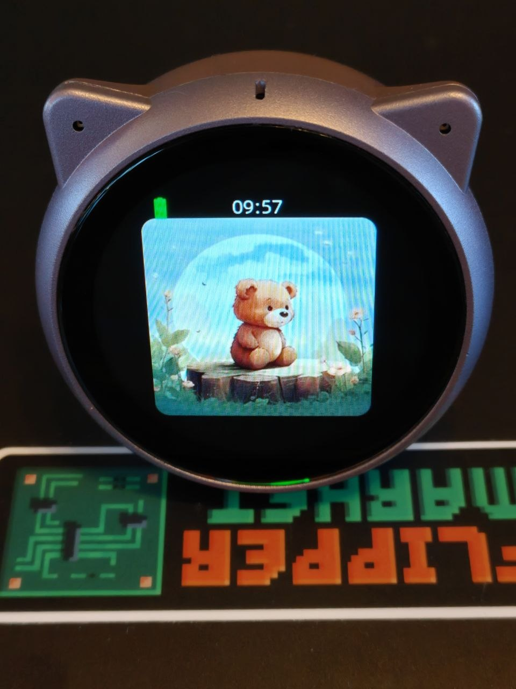
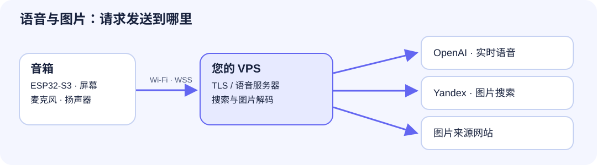

# EchoEar-ChatGPT-YandexApi

[English](README.md) · [Русский](README.ru.md) · **简体中文**

[](https://github.com/AlexeySmirnov74/EchoEar-ChatGPT-YandexApi/releases/latest)
[](https://github.com/AlexeySmirnov74/EchoEar-ChatGPT-YandexApi/actions/workflows/checks.yml)
[](firmware/main/boards/echoear-2st/README.md)
[](firmware/sdkconfig.echowear-reference)

[](server/install/README.md)
[](server/README.md)
[](server/image-search/)
[](server/gateway/)
[](README.md)

[](LICENSE)
[](server/voice/LICENSE)

将 EchoEar-2ST 音箱变成连接自有 VPS 的语音助手：通过 OpenAI Realtime API 对话，使用 Yandex Search API 查找图片，设置本地闹钟，并用语音控制屏幕。图片来自**互联网搜索**，不通过 OpenAI 生成。



**[下载 v0.2.0 固件](https://github.com/AlexeySmirnov74/EchoEar-ChatGPT-YandexApi/releases/latest)** · **[USB 刷写与恢复指南](docs/FLASHING.md)** · **[VPS 安装指南](server/install/README.md)**

适用硬件为**不带 BaseBoard 接口的 EchoEar-2ST**，配备 ESP32-S3、16 MiB Flash 和 8 MiB PSRAM。固件与服务器已在一台匹配设备上配合使用。其他硬件版本的引脚和分区可能不同。详细刷写和服务器安装指南目前为俄文；三个语言版本的 README 介绍的是同一项目。文档翻译不会改变固件当前的俄语界面、语音配置或 UTC+5 时区。

## 工作原理



音箱通过经过身份验证的 TLS/WebSocket 连接访问您的 VPS。VPS 将语音数据发送给 OpenAI，将图片搜索词发送给 Yandex，并可能从图片来源网站下载所选图片。VPS 是音箱的连接入口；相关外部服务也会收到完成相应功能所需的数据。

API 密钥保存在 VPS 上。分发的固件不包含个人 VPS 地址、Wi-Fi 密码或 API 密钥。您可以通过音箱的浏览器 Wi-Fi 配置页面保存自己的 HTTPS OTA 地址；WebSocket 使用相同的主机和端口。此板型不使用旧的 MQTT 连接路径。

## 功能

- **触屏对话。** 识别到触摸时播放短提示音，支持后续对话。正在收听时再次触摸可能会停止当前收听。
- **语音控制。** 调整音量和屏幕亮度，查询**估算的**电池电量。
- **图片。** 通过语音搜索图片，显示约 30 秒，也可以将当前图片固定为背景或移除。固定背景保存在服务器上，重新连接后恢复。
- **本地闹钟。** 铃声循环播放，直到触摸屏幕停止。音量过低时会临时提高，结束后恢复。设备保持供电且时钟已设置时，休息模式下也可响铃；完全断电后无法响铃。
- **屏幕休息模式。** 通过语音关闭屏幕背光、停止麦克风并断开 VPS 连接。触摸后播放本地唤醒提示并重新连接。已实现就绪提示，其实际播放仍需单独听音确认。
- **技术事件日志。** 可在 VPS 上单独启用有大小限制的语音会话事件日志，不保存录音或对话文本，也不等同于完整 USB 设备日志。

当前俄语固件使用的语音命令示例：

| 命令 | 功能 |
| --- | --- |
| «Установи громкость на 30 процентов» | 将音量设为 30%。 |
| «Установи яркость на 70 процентов» | 将亮度设为 70%。 |
| «Какой заряд батареи?» | 查询估算电量。 |
| «Покажи картинку зайчика» | 搜索并显示兔子的图片。 |
| «Сделай картинку постоянной» | 将当前图片固定为背景。 |
| «Убери картинку с экрана» | 移除图片。 |
| «Поставь будильник через две минуты» | 设置两分钟后的本地闹钟。 |
| «Иди спать» | 进入屏幕休息模式。 |
| «Что ты умеешь?» | 介绍可用命令。 |


休息模式仍保持设备供电；完全关机请使用音箱的实体按键。尚未集成音乐服务。图片搜索已启用家庭过滤，但不能保证所有结果都适合儿童；图片可能带水印，并受其所有者权利约束。

当前时钟和闹钟固定使用 **UTC+5（`Asia/Yekaterinburg`）**，不进行夏令时切换。支持其他时区需要同步修改固件和服务器。

## 改进与修复

本项目基于 [Denis-VR/xiaozhi-esp32](https://github.com/Denis-VR/xiaozhi-esp32/tree/41c79363538cce4513a1b4375758dd2f4f650fdb) 的提交 `41c79363538cce4513a1b4375758dd2f4f650fdb`。以下内容介绍本项目的 EchoEar-2ST 适配与配套服务器变更，不代表对所有上游版本或原厂固件的评价。

- **板型与语音后端。** 添加独立板型配置，支持显示、触摸、音频编解码器和电量估算；服务器使用 OpenAI Realtime 和 Yandex Search API。
- **清醒状态下保持连接。** 服务器支持 `persistent_idle` 时，音箱在各轮对话之间保留 WebSocket。服务器心跳、失效连接检测及逐步增加延迟的重连策略减少重复建连；进入休息模式时主动断开。
- **Wi-Fi 恢复。** 断网或 IP 变化后关闭旧会话。连接与关闭操作放在独立任务中，减少慢网络对主事件循环的影响。恢复仍取决于网络和服务器是否可用。
- **对话轮次处理。** 收听命令和响应关联当前轮次 ID，丢弃旧连接或旧轮次事件。使用独立的 `standby` 消息进入等待，再次触摸可以暂停收听。
- **音频传输。** 服务器加入有界帧队列、启动缓冲和按播放节奏发送 Opus 帧的机制，队列溢出后恢复会话。固件检查输入包长度并忽略已关闭连接的事件。一台设备的使用反馈显示播放更流畅；尚未对不同网络下的丢包和延迟进行量化测量。
- **播放队列。** 同时跟踪队列和已开始的解码、输出任务；重置后使旧音频任务失效。触摸提示音混入输出，并在提示音结束后开始收听。事件顺序导致首个音频包丢失的可能性仍未排除，相关另行提出的修复未包含在当前版本中。
- **休息与唤醒。** 软件休息模式关闭背光、麦克风和连接，同时保留本地闹钟。触摸可唤醒并重连。它不执行硬件断电，也不保证解决所有深度睡眠故障。
- **保护设置。** EchoEar-2ST 初始化 NVS 失败时停止启动，不再自动清空 Wi-Fi 等设置。其他板型保留原有处理方式。
- **诊断与控制。** 添加本地闹钟、音量与亮度语音控制、电量估算和有大小限制的服务器事件日志；WebSocket JSON 解析失败时不再打印无效消息内容。

实机已检查对话、触摸提示音、休息模式及休息期间的闹钟。测试未覆盖所有闲置时长和网络故障。此前曾出现话语尚未结束就停止收听的现象，并未确认每次出现的具体原因。已验证发行版应用可启动并读取已保存的 OTA 地址；通过浏览器保存新地址仍需单独实机确认。

主要实现：[应用状态与重连](firmware/main/application.cc)、[WebSocket](firmware/main/protocols/websocket_protocol.cc)、[音频队列](firmware/main/audio/audio_service.cc)、[服务器帧传输](server/voice/internal/service/ai/manual_device_actor.go)。

## 所需条件

- 兼容的 EchoEar-2ST、支持数据传输的 USB 线和用于刷写的电脑。
- 独立的 Ubuntu 24.04 VPS、域名和有效的 TLS 证书。
- OpenAI API 访问权限、Yandex Search API 服务账号密钥及 Yandex Cloud 文件夹 ID。API 和 VPS 可能单独计费；订阅是否附带额度请在自己的账号中确认。
- 从源码构建时，需要 ESP-IDF 5.5.1 及 `firmware/dependencies.lock` 中的依赖版本。服务器使用 Docker，以及 Go、Node.js 和 Python 组件。


## 安装服务器

`server/` 包含语音服务、TLS/WebSocket 网关、图片搜索、解码器和设置面板。各组件的来源和构建限制见[服务器说明](server/README.md)。

在**独立、全新的 Ubuntu 24.04 VPS** 上，从克隆后的项目根目录运行：

```sh
sudo bash server/install/install.sh
sudo bash server/install/show-ota.sh
```

安装程序会要求输入域名、Let's Encrypt 邮箱、Yandex Cloud 文件夹 ID、两个 API 密钥及面板用户名和密码。密钥和密码在终端中隐藏输入。程序准备依赖、TLS 和容器；面板支持更新 Yandex 密钥和文件夹 ID。证书验证需要公网可访问且空闲的 **80** 端口，音箱需要访问 **18444** 端口。程序不覆盖现有 EchoWear 数据。

请先阅读[安装与恢复指南](server/install/README.md)。尚未在全新 VPS 上完成包含真实证书签发的端到端安装验证。内部语音与图片处理端口应保持私有，只向外开放经过身份验证的 TLS 网关。密钥和个人设置保存在仓库外。第二条命令显示需要填入音箱的服务器地址。

## 安装固件

从 [Releases](https://github.com/AlexeySmirnov74/EchoEar-ChatGPT-YandexApi/releases/latest) 下载 **`echoear-2st-usb-update-v0.2.0.zip`**。它更新应用，同时保留兼容的原有显示资源和设置。此包要求已有引导程序和资源分区，不适用于完全擦除的芯片。

请按 **[Windows/Linux USB 刷写、备份与恢复指南](docs/FLASHING.md)** 操作，包括两次完整备份、分区检查、完整读回验证及回滚。不要擦除整片 Flash，也不要把应用二进制文件写到地址零。

刷写后，用手机或电脑连接音箱的配置热点，打开 **http://192.168.4.1**，进入 **“高级”（Дополнительно / Advanced）**，保存自己的 HTTPS OTA 地址，然后配置家庭 Wi-Fi 并重启。地址在浏览器里输入，不是在音箱触屏上输入。OTA 与 WebSocket 必须使用相同主机和端口。详见[设备配置](device/README.md)。

## 从源码构建

准备 ESP-IDF 后，进入 `firmware` 目录：

```sh
cp -n sdkconfig.echowear-reference sdkconfig
idf.py build
```

`cp -n` 不覆盖已有本地配置。共享模板使用无效的示例 URL。如需在编译时额外设置私有备用地址，可改用 `python3 ../device/configure_ota.py`；生成的配置和二进制文件会包含该地址，应保留为私有文件。通过门户配置则不需要为每台设备重新编译。

### 自动检查

GitHub Actions 的 **Checks** 工作流会编译并运行固件主机测试，同时测试设备工具、网关和设置面板。测试仅使用测试凭据，不调用 OpenAI 或 Yandex。徽章显示该工作流的真实状态，不代表完整 ESP-IDF 构建、硬件测试或部署结果。

在 Linux 上本地运行固件和设备工具检查：

```sh
bash firmware/tests/run_nvs_init_host_tests.sh
bash firmware/tests/run_no_legacy_tests.sh
bash firmware/tests/run_rest_host_tests.sh
python3 -m unittest discover -s device -p 'test_*.py'
```

## 常见问题

| 问题 | 检查内容 |
| --- | --- |
| 没有 USB 串口 | 数据线、供电、USB 接口和驱动；端口名称因系统而异。 |
| 没有语音回答 | 只触摸一次，等待收听指示后讲话，期间不要再次触摸；检查 Wi-Fi、VPS 和技术事件日志。 |
| 唤醒缓慢 | 休息模式会断开连接，重连需要 Wi-Fi、可访问的 VPS 和有效证书。 |
| 找不到图片 | 检查 Search API 结果及服务器到图片网站的访问；无结果和搜索错误不是同一种情况。 |
| 闹钟不响 | 设备需保持供电、时钟已设置且闹钟已保存；完全断电无法响铃。 |
| 仍连接旧服务 | 确认安装了本项目固件并保存自己的 OTA 地址；其他固件或重置后的设置可能有不同表现。 |

## 来源与许可证

- 本项目新增的原创文件使用 [MIT](LICENSE)，不替代上游和各组件的许可证。
- 固件基于 [Denis-VR/xiaozhi-esp32](https://github.com/Denis-VR/xiaozhi-esp32)，快照提交为 `41c79363538cce4513a1b4375758dd2f4f650fdb`，保留其 [MIT 许可证](firmware/LICENSE)。
- 板型研究参考 [Muse OSTB EchoEar-2ST 文档](https://github.com/facebookincubator/muse-gadget-sdk/blob/8d32b7fa8d6d9b600ea65fc956e9418f5c778a28/esp32/devices/ostb-echoear-2st.md)，显示初始化来源声明保留在代码中。
- 语音服务器基于 [stackchan-ai-server](https://github.com/rudyll/stackchan-ai-server)，保留 [AGPL-3.0-only](server/voice/LICENSE)、[NOTICE](server/voice/NOTICE.md) 及 `server/voice/licenses/` 中的单独声明。
- 附带的 [esp-ml307 组件](firmware/components/esp-ml307/LICENSE) 使用 Apache-2.0。其他依赖保留各自许可条件。

组件与许可证对照见 [NOTICE.md](NOTICE.md)。分发或运行修改后的组件时，请按相关许可保留声明并在适用时提供对应源码。许可证徽章分别标注新增项目代码和服务器；整个仓库并非统一使用 MIT 许可证。
